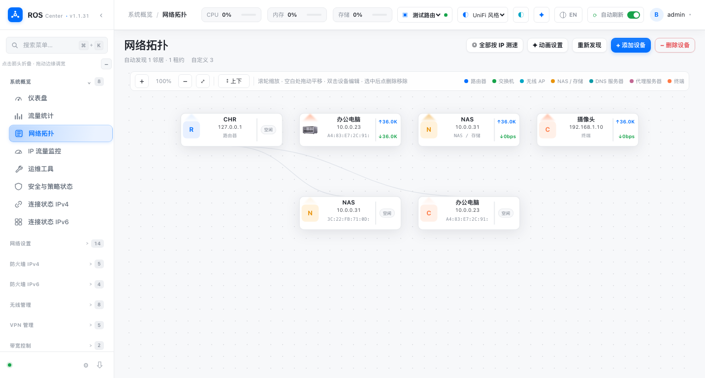
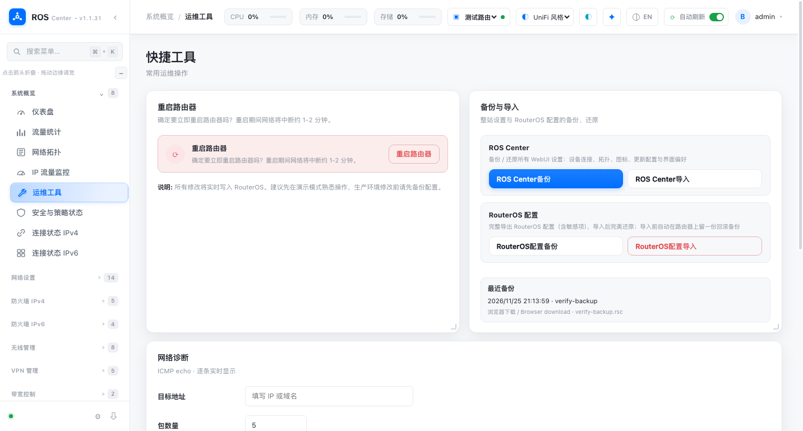
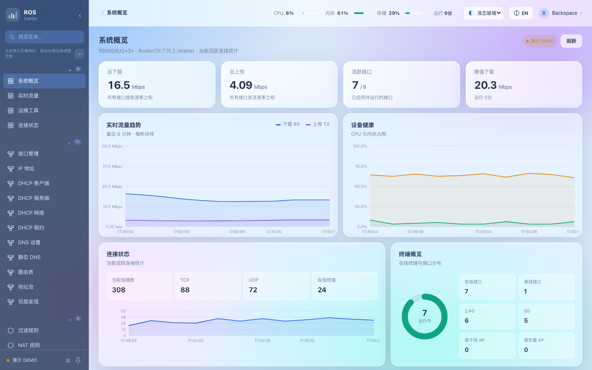

# ROS Center · RouterOS 管理中心

[English 文档](README_EN.md)

轻量、零运行时依赖的 RouterOS 多设备管理中心：实时流量、流量统计、分类配置、网络拓扑、备份还原，全部装进一个 Docker 镜像。通过 RouterOS API（8728/8729）读写，无需在路由器安装脚本或容器。

## 界面预览

| 仪表盘 | 网络拓扑 |
| --- | --- |
|  |  |

| 备份与导入 | 液态玻璃主题 |
| --- | --- |
|  |  |

更多截图见 [docs/screenshots](docs/screenshots)。

## 功能

- **多设备**：顶栏切换，设备增删改查 / 测试连接 / 主设备；每台设备独立连接、历史与配置缓存
- **仪表盘**：原生 `monitor-traffic` 实时推流，总上下行 / 趋势曲线 / 接口类型分布 / 连接排行 / 设备健康；块可拖拽排序与显隐
- **流量统计**：读取接口真实计数器，每秒采样、按网口按天累计，重拨自动续计；今日/本周/本月/累计趋势
- **网络拓扑**：邻居 + DHCP 自动发现，层级拖拽、缩放平移、每节点图标与实时上下行；类型色手电筒灯光随流量增强；支持按 IP/MAC 实时测速（填 MAC 自动发现 IPv4 + IPv6 双栈地址并汇总，SLAAC 地址变化也能跟上）、流量计算模式
- **分类配置**：接口 / IP / DHCP / DNS / 路由 / 防火墙 / WiFi / AC / PPP / WireGuard / 队列 / 用户 / 脚本等，增删改查、搜索、排序、列与块尺寸可调；DHCP 租约复用拓扑设备实时速率
- **备份与导入**：一键备份 / 还原全部 WebUI 设置，以及 RouterOS 完整配置（含敏感项，导入前自动留回滚备份）
- **运维工具**：重启、网络诊断（ICMP 逐条实时）、实时事件流、最近配置更改；检查更新与应用内自动更新；一键配置上网参数
- **双语与主题**：中英一键切换；14 套配色 × 浅色/深色/跟随系统任意组合（含苹果风液态玻璃）
- **安全**：WebUI 会话登录，凭据 AES-256-GCM 加密落盘

## 快速开始

Docker Compose（推荐）：

```bash
mkdir ros-center && cd ros-center
curl -O https://raw.githubusercontent.com/BackspaceM/ros-center/main/docker-compose.yml
mkdir -p data && docker compose up -d
```

打开 `http://<宿主机IP>:10086`，在「系统管理 → 设备管理」添加 RouterOS 即可。连接参数、账号密码、主题、更新设置都在 WebUI 里修改，无需 `.env`。

其他方式（桌面安装包 / 绿色版 / 本机 Node 运行）见 [Releases](https://github.com/BackspaceM/ros-center/releases)。

## RouterOS 侧准备

建议只读账号（仅查看时）：

```routeros
/user group add name=webui policy=read,api
/user add name=webui group=webui password=改成强密码
/ip service set api address=10.0.0.0/24
/ip firewall filter add chain=input protocol=tcp dst-port=8728 src-address=10.0.0.0/24 action=accept place-before=0
```

需要写配置时，再给对应账号授权必要菜单；不要用 full 权限账号。

## 安全提醒

默认 API（8728）明文，仅用于可信内网，公网请启用 API-SSL（8729）并配置证书。WebUI 暴露到公网前请设置登录密码并前置 HTTPS 反向代理。`data/` 保存全部设置与统计，请整体持久化并限制权限。

## 许可

MIT
