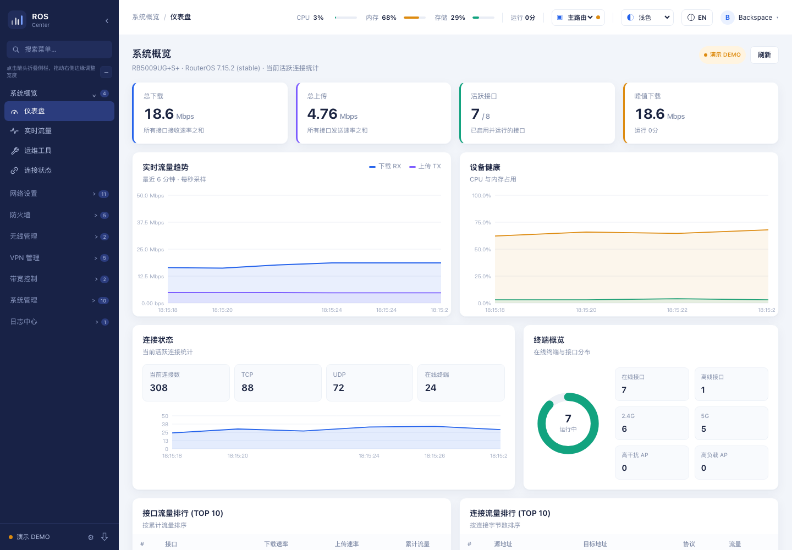
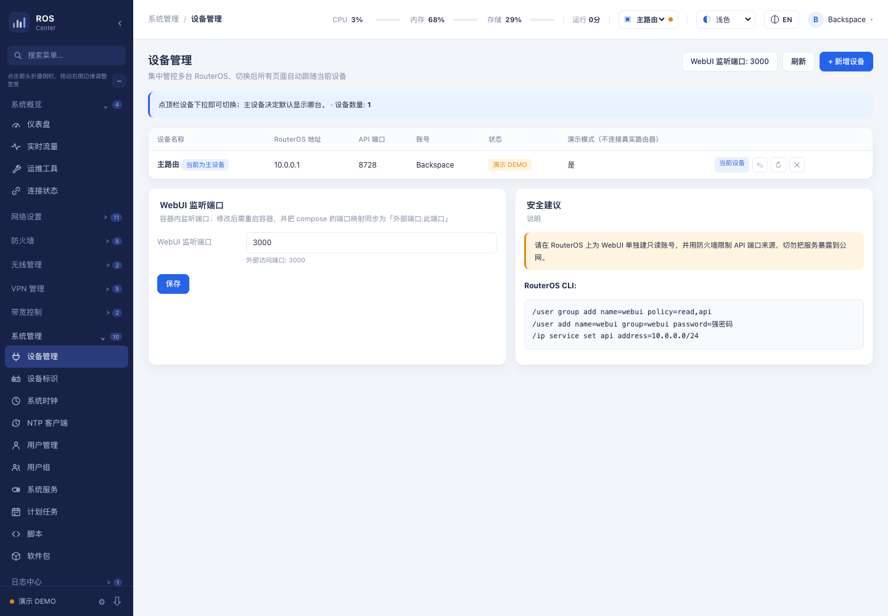
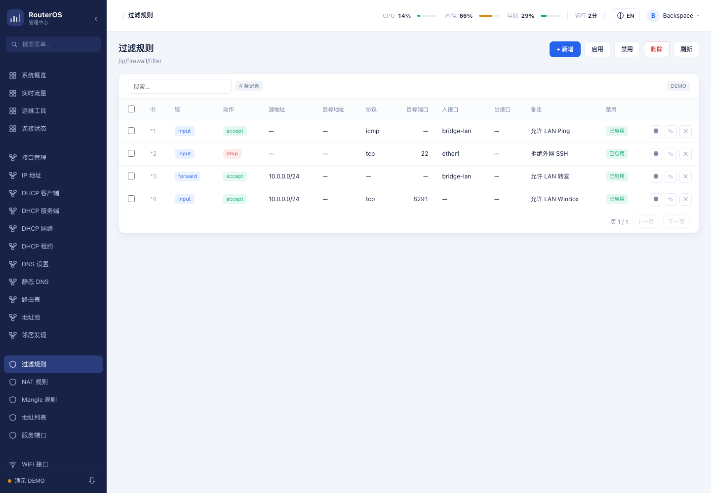
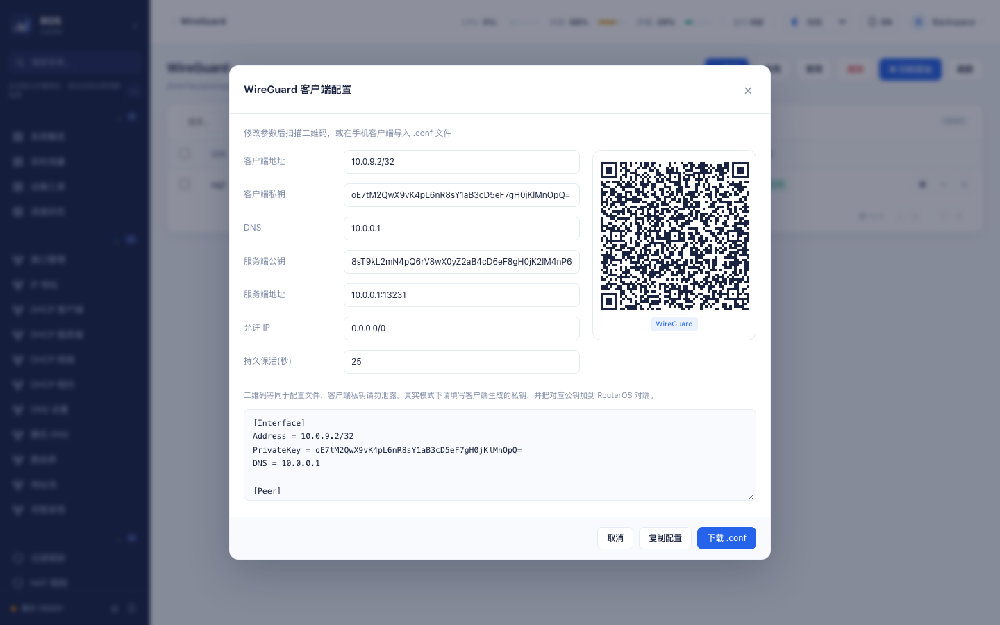
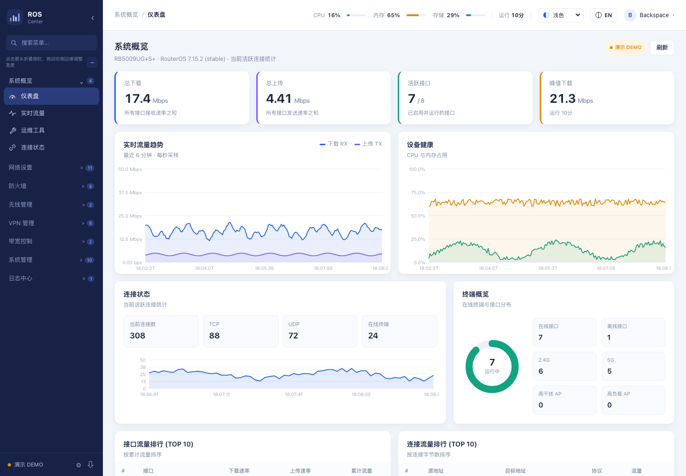

# ROS Center · RouterOS 管理中心

> 一个轻量、零运行时依赖的 RouterOS 多设备管理中心：实时流量、流量统计、分类配置、双语界面、双轴主题，全部装进一个 Docker 镜像。
> A lightweight, dependency-free RouterOS control center: live traffic, traffic statistics, categorized config management, bilingual UI, dual-axis themes — all in one Docker image.

[中文](#中文文档) · [English](#english)

---

## 中文文档

### 简介

ROS Center 通过 RouterOS API（8728 / 8729）只读取实时数据，并按需写入配置。它不占用路由器 CPU，不需要在 RouterOS 里安装任何脚本或容器；部署在局域网任意常开设备（小主机、NAS、VM、LXC）即可同时管控多台 RouterOS。

- **后端**：Node.js 内置模块实现，无 npm 运行时依赖
- **前端**：原生 HTML/CSS/JS，Canvas 绘图 + WebSocket 实时推流
- **数据**：每台设备独立连接、历史、配置缓存与日志，互不串台

### 功能亮点

- **多设备管控**：顶栏下拉切换；设备增删改查、测试连接、设为主设备、重连；配置持久化到 `data/devices.json`
- **仪表盘**：实时流量来自 RouterOS 原生 `monitor-traffic` 流式监听（设备每秒主动推送，无需反复查询）；总下载/上传/活跃接口/峰值卡片、双曲线趋势图、接口类型分布（按真实接口类型统计，无编造数据）、接口与连接排行。运行时间取自路由器 `/system/resource` 的真实 uptime
- **连接状态**：真实读取 RouterOS 连接表，分别统计 IPv4 / IPv6 / 汇总，且 TCP、UDP 各自再分 IPv4/IPv6（每 5 秒刷新），趋势图展示总数与双栈历史；另设 IPv4、IPv6 两个连接明细分类
- **流量统计（真实 · 实时 · 按网口按天）**：数据源只有 RouterOS `/interface/print` 的 `rx-byte` / `tx-byte` **真实累计字节计数器**，每秒采样、按网口逐个求差分，写入「网口 × 小时」和「网口 × 天」桶；不估算、不灌假数据，演示/离线时统计不累计并明确标注。**重拨自动续计**：PPPoE 重拨、接口重建、路由重启把计数器清零时，不再丢弃采样，而是把清零后的计数器值作为自清零以来的真实字节计入（页面显示清零次数），当天/当月累计不会归零或停记。**范围可切换**：今日 / 本周 / 本月 / 累计，卡片、趋势、明细同步切换（今日按小时、周/月按天、累计按月），每 2 秒刷新、数字实时增长。**网口多选**：顶部直接列出真实网口的复选框 chip，点选即生效，另有「自定义」输入通配符（`pppoe-*`、`vlan??`）；建议只选 WAN 口避免 LAN + WAN 双算。明细按「时间 + 网口」逐行列出每个网口的下载/上传，**每页 3 行**可翻页，每段先给「全部网口（小计）」再逐网口展开。历史按「日 × 网口」保存，切换范围即时精确重算，不重置基线、不丢历史、不混入其他网口；持久化在 `data/usage.json`，旧版按小时记录自动迁移补出每日每网口数据；服务停机期间的真实差分只计入当日合计，不虚构小时分布

流式监听不可用时（旧版 RouterOS 或网络限制）自动回退到轮询，并每 10 秒重试一次恢复流式。可用 `TRAFFIC_STREAM=0` 强制只用轮询。
- **分类配置**：9 组 44 个分类，接口、IP、DHCP、DNS、路由、防火墙 IPv4/IPv6（Filter/NAT/Mangle/地址列表/服务端口）、WiFi、PPP、WireGuard、队列、用户、系统服务、计划任务、脚本等，支持新增/编辑/启用/禁用/删除/搜索/表头排序/分页；RouterOS 的十六进制 `.id` 显示为十进制序号。脚本分类按官方文档处理：`/system/script` 没有 `disabled` 字段，因此工具栏是**「运行」**（调用 `/system/script/run` + `.id`）而不是启用/禁用，并显示只读的「运行次数」「上次运行」
- **WireGuard 扫码添加**：行内扫码按钮打开 WinBox 风格对端表单（名称、接口、私钥可手填或一键生成、公钥、Endpoint/端口、允许地址、预共享密钥、持久保活、responder 等），实时生成客户端配置二维码，可保存回 RouterOS、复制或下载 `.conf`
- **中英双语**：右上角一键切换，界面、表单、提示、错误全部双语
- **配色 × 深浅 双轴主题**：13 套配色（经典蓝、深海、极光、樱粉、森林绿、琥珀金、紫罗兰、咖啡棕、薄荷绿、黑白极简、毛玻璃、青花瓷、液态玻璃）与浅色/深色/跟随系统三种明暗**可任意组合**（例如「深色 + 樱粉」）；深浅模式用顶栏 ☀/☾/◐ 日月图标一键切换，配色下拉独立选择。**主题完整覆盖侧边栏**：底色、hover、选中高亮、图标、logo、侧栏纹样都随配色与深浅一起变化；图表与 SVG 同步换色。青花瓷主题改为白瓷地 + 钴蓝团花/缠枝纹（浅色）与夜蓝釉（深色），卡片与顶栏带青花描边，登录页同步
- **侧栏折叠**：分组整体折叠/展开、单个分组折叠、侧栏收窄为图标条、拖动调整宽度
- **WebUI 登录页**：会话 Cookie 登录页 + 侧栏退出按钮；也可在「系统管理 → 设备管理 → 安全建议」里直接设置账号密码（哈希存 `data/auth.json`）。原有 `WEB_USER` / `WEB_PASSWORD` Basic 认证继续兼容

### 页面展示

**仪表盘**（卡片、双折线图、设备健康、TOP 排行，顶栏可切换设备）



**设备管理**（新增/编辑/测试连接/设为主设备/重连/删除，WebUI 端口设置）



**设备管理 · 英文 + 深色主题**


**分类配置表格**（防火墙规则，行内启禁用/编辑/删除）



**WireGuard 扫码添加**（二维码实时生成，配置可复制/下载）



**液态玻璃主题**


**分组折叠导航**（每组带数量，默认只展开当前分组）



### 快速开始

#### 方式一：Docker Hub 镜像（推荐）

```bash
mkdir -p ros-center && cd ros-center
docker run -d --name ros-center --restart unless-stopped \
  -p 10086:10086 \
  -v "$PWD/data:/app/data" \
  backspacem/ros-center:latest
```

打开 `http://小主机IP:10086`，进入 **系统管理 → 设备管理**，添加 RouterOS 即可。无需写 `.env`。

#### 方式二：Docker Compose

```bash
git clone https://github.com/BackspaceM/ros-center.git
cd ros-center
cp .env.example .env
# 如需改端口：WEB_PORT=8080 CONTAINER_PORT=10086（默认两者均为 10086）
# 默认直接拉取 Docker Hub 官方镜像 backspacem/ros-center:latest：
docker compose up -d
# 如需用本地源码构建，则改用：docker compose up -d --build
```

默认 `DEMO_MODE=0`，启动即连接真实路由器。仅当想单独预览界面时才设为 `1`：此时页面会明确标注「演示 DEMO」，**流量统计不会写入任何演示数据**。连不上路由器时显示「离线 OFFLINE」并保留最后一次真实值，不会注入假数据或估算值。

#### 方式三：本机直接运行

```bash
git clone https://github.com/BackspaceM/ros-center.git
cd ros-center
node server.js          # Node.js 18+，无需 npm install
```

### 配置方法

**方法 1（推荐）：WebUI 设备管理页**

系统管理 → 设备管理 → 新增设备：填写名称、地址、端口、账号、密码、API-SSL、演示模式 → 先点「测试连接」→ 保存。每台设备独立保存，配置写入 `./data/devices.json`（权限 0600）。**账号和密码用 AES-256-GCM 加密后落盘**，不再是明文：密钥默认在 `./data/secret.key`（首次启动随机生成，权限 0600），也可用环境变量 `ROS_CENTER_KEY` 指定（容器重建 / 只挂部分数据卷时建议设置，否则密钥丢失需重新录入密码）；旧版明文配置启动时会就地自动迁移为密文，前端与所有 API 都不会回显密码。

**方法 2：`.env` 环境变量（仅作为第一台设备的初始值）**

| 变量 | 默认值 | 说明 |
| --- | --- | --- |
| `WEB_PORT` | `10086` | 宿主机访问端口 |
| `CONTAINER_PORT` | `10086` | 容器内监听端口，改完需同步修改 compose 端口映射并重启 |
| `ROS_HOST` | `192.168.88.1` | 第一台 RouterOS 地址 |
| `ROS_PORT` | `8728` | API 端口；API-SSL 用 `8729` |
| `ROS_TLS` | `0` | `1` 启用 API-SSL |
| `ROS_USER` / `ROS_PASSWORD` | `monitor` / 空 | RouterOS 账号密码 |
| `TRAFFIC_STREAM` | `1` | `1` 使用 RouterOS 原生 monitor 流式推送；`0` 强制轮询回退 |
| `TRAFFIC_STREAM_RETRY_MS` | `10000` | 流式断开后重试间隔（毫秒） |
| `POLL_INTERVAL_MS` | `1000` | 轮询/系统资源刷新间隔（毫秒，最低 500） |
| `CONN_POLL_INTERVAL_MS` | `5000` | 连接数统计刷新间隔（毫秒，最低 3000） |
| `HISTORY_POINTS` | `180` | 图表保留点数 |
| `DEMO_MODE` | `0` | `1` = 仅界面演示（明确标注 DEMO，统计不累计），不连路由器 |
| `ROS_CENTER_KEY` | 空 | 可选：设备凭据加密密钥；留空则用 `data/secret.key`。更换后需重新录入密码 |
| `DOCKER_IMAGE` | `backspacem/ros-center:latest` | compose 使用的镜像名 |
| `WEB_USER` / `WEB_PASSWORD` | 空 | 可选 WebUI 登录账号密码（Basic Auth 兼容）；也可在网页「设备管理 → 安全建议」中设置，优先级更高 |

网页里保存的配置（`data/devices.json`、`data/auth.json`）优先级高于 `.env`。登录会话写在 `data/session.secret` 签名的 HttpOnly Cookie 中，7 天有效；侧栏 `⎋` 退出。关闭登录保护会写入 `{"disabled": true}` 到 `data/auth.json`。`data/` 目录建议整体持久化（`devices.json` 密文 + `secret.key` 密钥 + `usage.json` 统计历史 + `auth.json` 哈希），不要只挂单个文件。

**RouterOS 侧准备**（建议用只读账号）：

```routeros
/user group add name=webui policy=read,api
/user add name=webui group=webui password=改成强密码
/ip service set api address=10.0.0.0/24
/ip firewall filter add chain=input protocol=tcp dst-port=8728 src-address=10.0.0.0/24 action=accept place-before=0
```

### 使用提示

- 顶栏设备下拉切换当前查看的路由器；`?device=<ID>` 或 `?dev=<设备名>` 可深链直达指定设备
- `?section=firewallFilter` 直跳分类（`?section=firewall6Filter` 为 IPv6 过滤）；`?action=add` 打开新增表单；`?action=wgqr` 打开 WireGuard 扫码弹窗
- 表格点任意表头切换升序/降序；`ID` 列显示 RouterOS 十六进制 `.id` 对应的十进制序号，鼠标悬停可看原始 `.id`
- DNS/设备标识/时钟/NTP 为单例配置，以参数卡片展示，点「编辑」直接修改
- `?lang=en` 英文；`?theme=liquid` 指定配色、`?mode=dark` 指定深浅（light/dark/system）；`?collapse=1` 折叠侧栏
- 流量统计页每 2 秒自动拉取后端真实统计（后端每秒采样），局部刷新卡片 / 图表 / 明细，不会整页抖屏；明细今日按小时、周/月按天、累计按月，每页 3 行；`'实时流量'` 独立页已并入仪表盘，不再单独列出
- 统计网口在页面顶部多选，也可用 HTTP 接口：`GET /api/usage?range=today|week|month|total` 读取汇总、真实网口清单和该范围的按网口明细，`POST /api/usage` 带 `{"interfaces":["ether1","pppoe-*"]}` 保存参与统计的网口（空数组 = 全部），可用 `?device=<ID>` 指定设备；每台设备的选择独立持久化在 `data/usage.json`，返回体含 `dataReal` / `source` / `sampleTs` / `resets` / `resetLog` / `gaps` 便于核验数据真实性与重拨次数
- 脚本运行走 `POST /api/config` 的 `{"section":"scripts","action":"run","ids":["*1"]}`，后端只调用 `/system/script/run` + `.id`；演示模式或离线时直接报错，不假装成功
- 写操作走「路径白名单 + 字段白名单」双重校验，危险操作需二次确认，所有写操作记录到日志

### 安全提醒

默认 API（8728）是明文，只在可信内网使用，并用防火墙限制来源 IP；公网环境请启用 API-SSL（8729）并配置证书。若需要写配置，请单独建一个仅授权必要菜单的 RouterOS 用户，不要用 full 权限账号。WebUI 暴露到公网前请在「设备管理 → 安全建议」里启用登录密码（或设置 `WEB_USER` / `WEB_PASSWORD`），并前置 HTTPS 反向代理。RouterOS 账号密码在 `data/devices.json` 中以 AES-256-GCM 密文保存（密钥 `data/secret.key` 或 `ROS_CENTER_KEY`），WebUI 登录密码为 scrypt 哈希；请同时保护 `data/` 目录权限并持久化整个目录。

---

## English

### Overview

ROS Center is a lightweight RouterOS control center with zero runtime npm dependencies. It reads live data and writes configuration through the RouterOS API (8728/8729). Nothing runs on the router itself — deploy it on any always-on device in your LAN (mini PC, NAS, VM, LXC) and manage multiple routers from a single dashboard.

- **Backend**: Node.js built-in modules only
- **Frontend**: vanilla HTML/CSS/JS, Canvas charts + WebSocket streaming
- **Data**: per-device connection, history, config cache and logs — fully isolated

### Features

- **Multi-router management**: switch devices from the top bar; add/edit/delete, test connection, set primary, reconnect; persisted in `data/devices.json`
- **Dashboard**: live traffic from RouterOS native `monitor-traffic` streaming (the device pushes a fresh sample every second, no repeated polling); download/upload/active ports/peak cards, dual-line charts, interface-type distribution (from real interface types, no invented numbers), interface & connection rankings. Uptime comes from the router's real `/system/resource` uptime
- **Connection status**: reads the real RouterOS connection table and reports IPv4 / IPv6 / total, with TCP and UDP each further split by IPv4/IPv6 (refreshed every 5s), plus a dual-stack history chart; separate IPv4 and IPv6 connection detail sections
- **Traffic statistics (real, live, per interface per day)**: the only data source is the real cumulative byte counters `rx-byte` / `tx-byte` from RouterOS `/interface/print`, sampled every second and differenced per interface into "interface × hour" and "interface × day" buckets. No rate integration, random numbers or estimates; demo/offline never accumulates and is clearly labelled. **PPPoE redial carry-forward**: when a redial, interface re-creation or router reboot resets a counter, the sample is no longer discarded — the post-reset counter value is the real byte count since the reset and keeps accumulating (reset count shown on the page), so the day/month total neither zeroes nor stops. **Selectable ranges**: Today / This week / This month / All time switch cards, chart and details together (hourly today, daily week/month, monthly all-time), refreshed every 2 seconds so numbers grow live. **Multi-select interfaces**: a checkbox chip for every real router interface, applied on click, plus a "Custom" field for wildcards (`pppoe-*`, `vlan??`). Pick only the WAN uplink to avoid double counting LAN + WAN. The detail table lists time + interface rows, i.e. exactly how much each port downloaded/uploaded per day (hourly for today), **3 rows per page**, with an "All interfaces (subtotal)" row before each bucket. History is stored per "day × interface": re-scoping recomputes exactly with no baseline reset or lost history. Persisted in `data/usage.json`; legacy hourly history is migrated automatically; real deltas during a service outage go to the day total only, never invented as hourly data

If streaming is unavailable (older RouterOS or restricted networks), the app falls back to polling and retries streaming every 10 seconds. Set `TRAFFIC_STREAM=0` to force polling.
- **Categorized config**: 9 groups, 44 sections — interfaces, IP, DHCP, DNS, routes, separate IPv4/IPv6 firewall (filter/NAT/mangle/address lists/service ports), WiFi, PPP, WireGuard, queues, users, services, schedules, scripts — with add/edit/enable/disable/delete/search/column sorting/pagination. RouterOS hex `.id` values are shown as decimal sequence numbers. Scripts follow the official docs: `/system/script` has no `disabled` property, so the toolbar offers **Run** (`/system/script/run` with `.id`) instead of enable/disable, plus read-only "Run count" and "Last started" columns
- **WireGuard QR**: in-row scan button opens a WinBox-style peer form (name, interface, private key with one-click generation, public key, endpoint/port, allowed address, preshared key, persistent keepalive, responder...), generates a client QR, saves back to RouterOS, and copies/downloads `.conf`
- **Bilingual UI**: one-click Chinese/English switch across labels, forms, hints and errors
- **Dual-axis color × lightness themes**: 13 color schemes (classic blue, deep sea, aurora, sakura, forest, amber, violet, coffee, mint, mono, glass, porcelain, liquid glass) combined freely with light / dark / system lightness (e.g. "dark + sakura"); light/dark is a one-click sun/moon icon in the top bar, color scheme is a separate dropdown. **Themes fully cover the sidebar** — background, hover, active highlight, icons, logo and sidebar texture all follow the chosen color scheme and lightness; charts and SVGs follow as well. The porcelain theme is now white porcelain with cobalt-blue floral / vine patterns (a night-blue glaze in dark mode), with blue trim on cards and the top bar; the sign-in page matches
- **Collapsible sidebar**: collapse groups or the whole sidebar, drag to resize
- **WebUI sign-in page**: session-cookie login page and sidebar sign-out; set credentials in "System → Devices → Security tip" (hashed in `data/auth.json`). Legacy `WEB_USER` / `WEB_PASSWORD` Basic auth still works

### Screenshots

| Page | Preview |
| --- | --- |
| Dashboard |  |
| Device manager |  |
| Device manager (EN / dark) |  |
| Firewall rules |  |
| WireGuard QR |  |
| Liquid glass theme |  |
| Collapsible navigation |  |

### Quick start

**Docker Hub image (recommended):**

```bash
mkdir -p ros-center && cd ros-center
docker run -d --name ros-center --restart unless-stopped \
  -p 10086:10086 \
  -v "$PWD/data:/app/data" \
  backspacem/ros-center:latest
```

Then open `http://<host-ip>:10086` and go to **System → Devices** to add your RouterOS. No `.env` editing required.

**Docker Compose:**

```bash
git clone https://github.com/BackspaceM/ros-center.git
cd ros-center
cp .env.example .env
# Pulls the official image backspacem/ros-center:latest by default:
docker compose up -d
# Use local source build instead: docker compose up -d --build
```

**From source:**

```bash
git clone https://github.com/BackspaceM/ros-center.git
cd ros-center
node server.js      # Node.js 18+, no npm install needed
```

### Configuration

**Recommended — Web UI:** System → Devices → Add. Fill name, host, port, username, password, TLS and demo mode, click **Test connection**, then save. Each device is stored independently in `data/devices.json` (mode 0600). **Usernames and passwords are encrypted at rest with AES-256-GCM** — no plaintext in JSON. The key defaults to `data/secret.key` (randomly generated on first start, mode 0600) or can be supplied via `ROS_CENTER_KEY` (recommended when rebuilding containers or mounting only part of the data volume; losing the key means re-entering passwords). Legacy plaintext configs are migrated in place at startup, and no API ever returns the password.

**Alternative — `.env` / environment variables** (initial values for the first device only):

| Variable | Default | Description |
| --- | --- | --- |
| `WEB_PORT` | `10086` | Host-side port |
| `CONTAINER_PORT` | `10086` | Container listen port; update the compose port mapping and restart to apply |
| `ROS_HOST` | `192.168.88.1` | First RouterOS address |
| `ROS_PORT` | `8728` | API port; use `8729` for API-SSL |
| `ROS_TLS` | `0` | `1` enables API-SSL |
| `ROS_USER` / `ROS_PASSWORD` | `monitor` / empty | RouterOS credentials |
| `TRAFFIC_STREAM` | `1` | `1` uses native RouterOS monitor streaming; `0` forces polling fallback |
| `TRAFFIC_STREAM_RETRY_MS` | `10000` | Retry interval in ms after a stream drops |
| `POLL_INTERVAL_MS` | `1000` | Polling / system resource refresh interval in ms (min 500) |
| `CONN_POLL_INTERVAL_MS` | `5000` | Connection count refresh interval in ms (min 3000) |
| `HISTORY_POINTS` | `180` | Chart history points |
| `DEMO_MODE` | `0` | `1` = UI demo only (clearly labelled, statistics do not accumulate), no router connection |
| `ROS_CENTER_KEY` | empty | Optional credential encryption key; uses `data/secret.key` when unset. Re-enter passwords after changing it |
| `DOCKER_IMAGE` | `backspacem/ros-center:latest` | Image used by compose |
| `WEB_USER` / `WEB_PASSWORD` | empty | Optional WebUI sign-in (legacy Basic auth compatible); can also be set under "Devices → Security tip", which takes precedence |

Settings saved in the Web UI take precedence over `.env`. `DEMO_MODE=0` is the default and connects to the real router; set it to `1` only to preview the UI (page is clearly labelled DEMO and no demo traffic is ever written into statistics). If the router is unreachable the UI shows OFFLINE and keeps the last real values — no fake or estimated data is injected. Persist the whole `data/` directory (encrypted `devices.json`, `secret.key`, `usage.json` history, `auth.json` hash), not just single files.

**RouterOS preparation** (read-only user recommended):

```routeros
/user group add name=webui policy=read,api
/user add name=webui group=webui password=change-me
/ip service set api address=10.0.0.0/24
/ip firewall filter add chain=input protocol=tcp dst-port=8728 src-address=10.0.0.0/24 action=accept place-before=0
```

### Tips

- Deep links: `?device=<ID>` / `?dev=<name>`, `?section=firewallFilter` (or `firewall6Filter` for IPv6), `?action=add`, `?action=wgqr`, `?lang=en`, `?theme=liquid` (color scheme), `?mode=dark` (light/dark/system), `?collapse=1`
- The statistics page polls the backend every 2 seconds (backend samples every second) and updates cards/chart/details in place, without repainting the whole page; details are hourly today, daily for week/month, monthly for all time, 3 rows per page; the separate "Live traffic" page has been merged into the Dashboard
- Interfaces are multi-selected at the top of the page, or via HTTP: `GET /api/usage?range=today|week|month|total` returns totals, real interface list and per-interface details for that range; `POST /api/usage` with `{"interfaces":["ether1","pppoe-*"]}` saves the counted interfaces (empty array = all); add `?device=<ID>` to target a router. Each device keeps its own selection in `data/usage.json`, and responses include `dataReal` / `source` / `sampleTs` / `resets` / `resetLog` / `gaps` to verify authenticity and redial counts
- Scripts run via `POST /api/config` with `{"section":"scripts","action":"run","ids":["*1"]}`; the backend only calls `/system/script/run` with `.id`. Demo mode or an offline router returns an error instead of pretending success
- Click any column header to toggle ascending/descending sort; the ID column shows the decimal form of RouterOS hex `.id` (hover for the raw value)
- DNS / identity / clock / NTP are singleton settings shown as parameter cards — click Edit to change
- Writes are constrained by path and field allowlists; destructive actions require confirmation and are logged.

### Security

Plain API (8728) is unencrypted — restrict it to a trusted LAN with firewall rules, or enable API-SSL (8729) with a proper certificate. Use a dedicated least-privilege RouterOS user for writes. Enable a WebUI login password under "Devices → Security tip" (or via `WEB_USER` / `WEB_PASSWORD`) and put an HTTPS reverse proxy in front before exposing it to the internet. RouterOS usernames/passwords are stored as AES-256-GCM ciphertext in `data/devices.json` (key in `data/secret.key` or `ROS_CENTER_KEY`); the WebUI password is an scrypt hash. Protect and persist the whole `data/` directory.
