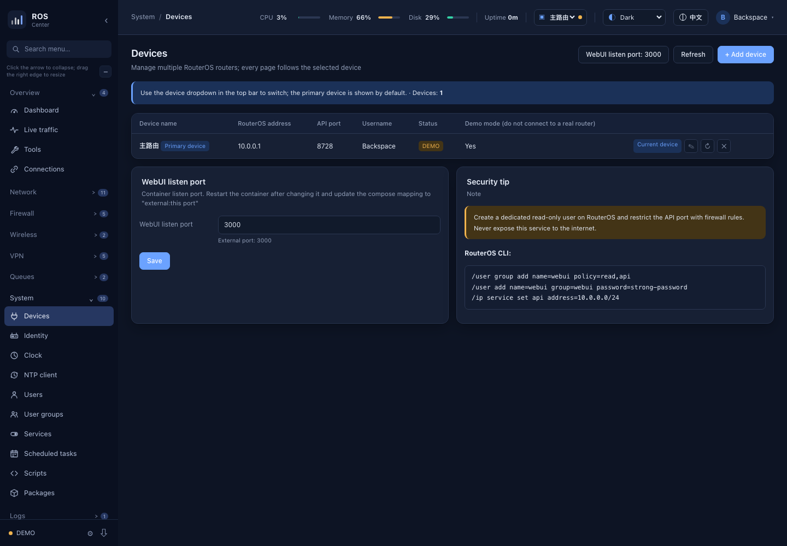

# ROS Center · RouterOS 管理中心

> 一个轻量、零运行时依赖的 RouterOS 多设备管理中心：实时流量、流量统计、分类配置、双语界面、双轴主题，全部装进一个 Docker 镜像。
> A lightweight, dependency-free RouterOS control center: live traffic, traffic statistics, categorized config management, bilingual UI, dual-axis themes — all in one Docker image.

[中文](#中文文档) · [English](#english)

---

## 中文文档

### 简介

ROS Center 通过 RouterOS API（8728 / 8729）只读取实时数据，并按需写入配置。它不占用路由器 CPU，不需要在 RouterOS 里安装任何脚本或容器；部署在局域网任意常开设备（小主机、NAS、VM、LXC）即可同时管控多台 RouterOS。

- **后端**：Node.js 内置模块实现，无 npm 运行时依赖
- **前端**：原生 HTML/CSS/JS，Canvas 绘图 + WebSocket 实时推流
- **数据**：每台设备独立连接、历史、配置缓存与日志，互不串台

### 功能亮点

- **多设备管控**：顶栏下拉切换；设备增删改查、测试连接、设为主设备、重连；配置持久化到 `data/devices.json`
- **仪表盘**：实时流量来自 RouterOS 原生 `monitor-traffic` 流式监听（设备每秒主动推送，无需反复查询）；总下载/上传/活跃接口/峰值卡片、双曲线趋势图、接口类型分布（按真实接口类型统计，无编造数据）、接口与连接排行。运行时间取自路由器 `/system/resource` 的真实 uptime
- **连接状态**：真实读取 RouterOS 连接表，分别统计 IPv4 / IPv6 / 汇总，且 TCP、UDP 各自再分 IPv4/IPv6（每 5 秒刷新），卡片按「总数 → IPv4 / IPv6 两组短卡片」紧凑排列、可横向滑动，趋势图展示总数与双栈历史；另设 IPv4、IPv6 两个连接明细分类
- **流量统计（真实 · 实时 · 按网口按天）**：只取 RouterOS `/interface/print` 的 `rx-byte` / `tx-byte` 真实累计计数器，每秒采样、按网口求差分，写入「网口 × 小时」和「网口 × 天」桶；不估算、不灌假数据，演示/离线不累计并明确标注。**重拨自动续计**：PPPoE 重拨、接口重建、路由重启清零计数器时，把清零后的值作为自清零以来的真实字节继续计入（页面显示清零次数），当天/当月不归零、不停记。**范围与网口联动**：今日 / 本周 / 本月 / 累计与网口多选合并为一条工具栏，趋势图只画「当前范围 + 当前网口」的真实数据（今日按小时、周/月按天、累计按月），副标题注明范围、粒度与网口；卡片每 2 秒刷新。页面只保留趋势图，不再列明细表。**网口多选**：真实网口 chip 点选即生效，另有通配符自定义（`pppoe-*`、`vlan??`）；建议只选 WAN 口避免 LAN + WAN 双算。历史按「日 × 网口」保存在 `data/usage.json`，旧版自动迁移；停机期间的真实差分只计入当日合计，不虚构小时分布

流式监听不可用时（旧版 RouterOS 或网络限制）自动回退到轮询，并每 10 秒重试一次恢复流式。可用 `TRAFFIC_STREAM=0` 强制只用轮询。
- **分类配置**：9 组 52 个分类，接口、IP、DHCP、DNS、路由、防火墙 IPv4/IPv6（Filter/NAT/Mangle/地址列表/服务端口）、WiFi、**AC 控制器 / AC 配置模板 / AC 自动配置 / AP 设置 / 在线 AP / AP 客户端**、PPP、WireGuard、队列、用户、系统服务、计划任务、脚本等，支持新增/编辑/启用/禁用/删除/搜索/表头排序/分页；AC/AP 分类按 RouterOS 7 WiFi 包路径（`/interface/wifi/...`）读写，在线 AP 与 AP 客户端为只读视图。RouterOS 的十六进制 `.id` 显示为十进制序号。脚本分类按官方文档处理：`/system/script` 没有 `disabled` 字段，因此工具栏是**「运行」**（调用 `/system/script/run` + `.id`）而不是启用/禁用，并显示只读的「运行次数」「上次运行」
- **WireGuard 扫码添加**：行内扫码按钮打开 WinBox 风格对端表单（名称、接口、私钥可手填或一键生成、公钥、Endpoint/端口、允许地址、预共享密钥、持久保活、responder 等），实时生成客户端配置二维码，可保存回 RouterOS、复制或下载 `.conf`
- **中英双语**：右上角一键切换，界面、表单、提示、错误全部双语
- **自动刷新与快捷搜索**：顶栏语言按钮后「自动刷新」开关（默认开、记忆偏好）统一控制各页刷新，新增设备后状态自动跟进；`⌘ K`（Win/Linux 为 `Ctrl K`）聚焦侧栏搜索并展开侧栏，Enter 跳首个结果、Esc 清空，搜索匹配分组名。仅演示模式显示 DEMO 提示
- **配色 × 深浅 双轴主题**：14 套配色（默认 **UniFi 风格**：浅色侧栏、白卡细边框、克制品牌蓝、大留白；另含经典蓝、毛玻璃、青花瓷、液态玻璃等）与浅色/深色/跟随系统三种明暗**可任意组合**；深浅模式用顶栏 ☀/☾/◐ 日月图标一键切换，配色下拉独立选择。**主题完整覆盖侧边栏**：底色、hover、选中高亮、图标、logo、侧栏纹样都随配色与深浅一起变化；图表与 SVG 同步换色。青花瓷主题改为白瓷地 + 钴蓝团花/缠枝纹（浅色）与夜蓝釉（深色），卡片与顶栏带青花描边，登录页同步
- **网络拓扑图**：「系统概览 → 网络拓扑」独立页面。自动读取 RouterOS 邻居表（LLDP/MNDP）与 DHCP 租约，层级**完全按用户填写的上下级关系推导**（可给主路由再挂光猫等上级设备，不再固定根节点），同层自动排布不重叠。固定上下分层布局、可一键切换左右视图（左右时最上级在左、下级在右、同级竖排一列）、滚轮缩放、拖拽平移、透明画布；颜色图例居中显示在画布上方，发现/自定义数量与当前点击动画显示在标题下方。所有设备都可自由拖动，只要不与其它设备重叠即可；**双击设备始终编辑该设备本身**（同 ID 覆盖，不会新增副本），编辑弹窗可填写「本层排序」（每层从 1 开始）直接指定同层左右顺序。多口交换机可登记「本机网口」，下挂设备标注「上级端口」（如 `ether3`）；端口信息只在编辑表单里维护，图中不再显示端口方块。可为节点上传图标并在卡片右侧显示实时速率（上行在上、下行在下）；速率优先取节点自带的接口，其次取填写的「上级端口」（如 `ether3`）对应接口的实时速率，因此手工添加的设备也有上下行数据。**每个设备可单独指定点击动画**（无 / 节点脉冲 / 链路流动 / 涟漪扩散），在拓扑页「动画设置」中配置；点击谁就播放谁的动画，并持续到点击另一台设备（已移除端口展开动画）。**双击设备编辑，选中后点工具栏「删除设备」移除**（自动发现的节点会被隐藏，删除其覆盖版本即可恢复）。上级 → 下级连线的涌动方向固定为父到子，速度按**下级设备的下行速率**对数比例调节（下级无速率则静止），因此后添加的上级设备也能正常涌动。**流量计算模式**：无法直接采集的设备（光猫、交换机等）可多选若干下级设备，按其速率之和显示，存在包含关系的选项自动互斥。配置按设备持久化到 `data/topology.json`，图标存于 `data/topology-icons/`（图标位于 `data/topology-icons/`，随 `./data` 卷一起持久化）
- **运维工具**：系统信息、备份配置、网络诊断三块（网络诊断在下方，结果框固定大小、预留约 5 行并可向上滚动查看历史）；ICMP 回复逐条实时写入表格，包数量不设上限，目标地址默认留空，可随时停止；配置备份改为**导出 `.rsc` 文件由浏览器下载到当前设备**（电脑/手机），不在 RouterOS 上生成备份文件
- **可选动效**：顶栏 ✦ 按钮一键开关动画（节点入场、连线流动、选中脉冲、弹窗与按钮微交互、主题过渡），偏好记忆在 `localStorage`，并遵循系统「减少动态效果」设置
- **侧栏折叠**：分组整体折叠/展开、单个分组折叠、侧栏收窄为图标条、拖动调整宽度
- **WebUI 登录页**：会话 Cookie 登录页 + 侧栏退出按钮；也可在「系统管理 → 设备管理 → 安全建议」里直接设置账号密码（哈希存 `data/auth.json`）。原有 `WEB_USER` / `WEB_PASSWORD` Basic 认证继续兼容

### 页面展示

**仪表盘**（卡片、双折线图、设备健康、TOP 排行，顶栏可切换设备）


**设备管理**（新增/编辑/测试连接/设为主设备/重连/删除，WebUI 端口设置）


**设备管理 · 英文 + 深色主题**



**分类配置表格**（防火墙规则，行内启禁用/编辑/删除）


**WireGuard 扫码添加**（二维码实时生成，配置可复制/下载）


**液态玻璃主题**


**分组折叠导航**（每组带数量，默认只展开当前分组）


### 快速开始

#### 方式一：Docker Hub 镜像（推荐）

```bash
mkdir -p ros-center && cd ros-center
docker run -d --name ros-center --restart unless-stopped \
  -p 10086:10086 \
  -v "$PWD/data:/app/data" \
  backspacem/ros-center:latest
```

打开 `http://小主机IP:10086`，进入 **系统管理 → 设备管理**，添加 RouterOS 即可。无需写 `.env`。

#### 方式二：Docker Compose

```bash
git clone https://github.com/BackspaceM/ros-center.git
cd ros-center
cp .env.example .env
# 如需改端口：WEB_PORT=8080 CONTAINER_PORT=10086（默认两者均为 10086）
# 默认直接拉取 Docker Hub 官方镜像 backspacem/ros-center:latest：
docker compose up -d
# 如需用本地源码构建，则改用：docker compose up -d --build
```

**Docker 映射与变量（要点）**

- 端口：`WEB_PORT`（宿主机）→ `CONTAINER_PORT`（容器内，默认 `10086`）
- 数据卷：`./data:/app/data` 保存设备、统计、拓扑与上传的图标（图标在 `data/topology-icons/` 子目录，已随父目录一起持久化，无需单独映射）
- 连接：`ROS_HOST` / `ROS_PORT` / `ROS_TLS` / `ROS_USER` / `ROS_PASSWORD` — RouterOS 地址、API 端口、TLS 与账号
- 采集：`POLL_INTERVAL_MS` / `CONN_POLL_INTERVAL_MS` / `TRAFFIC_STREAM` / `TRAFFIC_STREAM_RETRY_MS` / `HISTORY_POINTS` — 刷新间隔、流量流与图表点数
- 界面与存储：`DEMO_MODE` / `ROS_CENTER_KEY` / `WEB_USER` / `WEB_PASSWORD` / `DOCKER_IMAGE` — 演示开关、凭据加密密钥、WebUI 登录与镜像名

完整默认值见下方变量表。

默认 `DEMO_MODE=0`，启动即连接真实路由器。仅当想单独预览界面时才设为 `1`：此时页面会明确标注「演示 DEMO」，**流量统计不会写入任何演示数据**。连不上路由器时显示「离线 OFFLINE」并保留最后一次真实值，不会注入假数据或估算值。

**监控负载说明**：真实在线模式下，服务端每秒只请求一次 `/system/resource/print`；接口速率走 `/interface/monitor-traffic` 长连接推送（可用 `TRAFFIC_STREAM=0` 退回轮询）；连接表默认每 5 秒刷新一次（`CONN_POLL_INTERVAL_MS`）。拓扑页每 2.5 秒读取的是服务端内存快照，**不会额外访问 RouterOS**。该频率对主路由的负载很小，不需要再降频。

#### 方式三：本机直接运行

```bash
git clone https://github.com/BackspaceM/ros-center.git
cd ros-center
node server.js          # Node.js 18+，无需 npm install
```

### 配置方法

**方法 1（推荐）：WebUI 设备管理页**

系统管理 → 设备管理 → 新增设备：填写名称、地址、端口、账号、密码、API-SSL、演示模式 →「测试连接」→ 保存。每台设备独立保存到 `./data/devices.json`（0600）。**账号密码用 AES-256-GCM 加密落盘**：密钥默认 `./data/secret.key`（首次启动随机生成，0600），也可由 `ROS_CENTER_KEY` 指定（重建容器 / 只挂部分数据卷时建议设置，密钥丢失需重新录入）；旧版明文配置启动时自动迁移，API 不回显密码。

**方法 2：`.env` 环境变量（仅作为第一台设备的初始值）**

| 变量 | 默认值 | 说明 |
| --- | --- | --- |
| `WEB_PORT` | `10086` | 宿主机访问端口 |
| `CONTAINER_PORT` | `10086` | 容器内监听端口，改完需同步修改 compose 端口映射并重启 |
| `ROS_HOST` | `192.168.88.1` | 第一台 RouterOS 地址 |
| `ROS_PORT` | `8728` | API 端口；API-SSL 用 `8729` |
| `ROS_TLS` | `0` | `1` 启用 API-SSL |
| `ROS_USER` / `ROS_PASSWORD` | `monitor` / 空 | RouterOS 账号密码 |
| `TRAFFIC_STREAM` | `1` | `1` 使用 RouterOS 原生 monitor 流式推送；`0` 强制轮询回退 |
| `TRAFFIC_STREAM_RETRY_MS` | `10000` | 流式断开后重试间隔（毫秒） |
| `POLL_INTERVAL_MS` | `1000` | 轮询/系统资源刷新间隔（毫秒，最低 500） |
| `CONN_POLL_INTERVAL_MS` | `5000` | 连接数统计刷新间隔（毫秒，最低 3000） |
| `HISTORY_POINTS` | `180` | 图表保留点数 |
| `DEMO_MODE` | `0` | `1` = 仅界面演示（明确标注 DEMO，统计不累计），不连路由器 |
| `ROS_CENTER_KEY` | 空 | 可选：设备凭据加密密钥；留空则用 `data/secret.key`。更换后需重新录入密码 |
| `DOCKER_IMAGE` | `backspacem/ros-center:latest` | compose 使用的镜像名 |
| `WEB_USER` / `WEB_PASSWORD` | 空 | 可选 WebUI 登录账号密码（Basic Auth 兼容）；也可在网页「设备管理 → 安全建议」中设置，优先级更高 |

网页里保存的配置（`data/devices.json`、`data/auth.json`）优先级高于 `.env`。登录会话写在 `data/session.secret` 签名的 HttpOnly Cookie 中，7 天有效；侧栏 `⎋` 退出。关闭登录保护会写入 `{"disabled": true}` 到 `data/auth.json`。`data/` 目录建议整体持久化（`devices.json` 密文 + `secret.key` 密钥 + `usage.json` 统计历史 + `auth.json` 哈希），不要只挂单个文件。

**RouterOS 侧准备**（建议用只读账号）：

```routeros
/user group add name=webui policy=read,api
/user add name=webui group=webui password=改成强密码
/ip service set api address=10.0.0.0/24
/ip firewall filter add chain=input protocol=tcp dst-port=8728 src-address=10.0.0.0/24 action=accept place-before=0
```

### 使用提示

- 顶栏设备下拉切换当前查看的路由器；`?device=<ID>` 或 `?dev=<设备名>` 可深链直达指定设备
- `?section=firewallFilter` 直跳分类（`?section=firewall6Filter` 为 IPv6 过滤）；`?action=add` 打开新增表单；`?action=wgqr` 打开 WireGuard 扫码弹窗
- 表格点任意表头切换升序/降序；`ID` 列显示 RouterOS 十六进制 `.id` 对应的十进制序号，鼠标悬停可看原始 `.id`
- DNS/设备标识/时钟/NTP 为单例配置，以参数卡片展示，点「编辑」直接修改
- `?lang=en` 英文；`?theme=liquid` 指定配色、`?mode=dark` 指定深浅（light/dark/system）；`?collapse=1` 折叠侧栏
- 流量统计页每 2 秒自动拉取后端真实统计（后端每秒采样），局部刷新卡片 / 趋势图，不会整页抖屏；页面只有趋势图、没有明细表，趋势随「今日 / 本周 / 本月 / 累计」与所选网口联动（今日按小时、周/月按天、累计按月）；`'实时流量'` 独立页已并入仪表盘，不再单独列出
- 顶栏「自动刷新」开关统一控制页面刷新（统计 2 秒、配置 5 秒），关闭后不再自动拉取；`⌘ K` / `Ctrl K` 聚焦侧栏搜索，Enter 跳首个结果、Esc 清空；搜索匹配分组名
- 统计网口在页面工具栏多选，也可用 HTTP 接口：`GET /api/usage?range=today|week|month|total` 读取汇总、真实网口清单和该范围的趋势序列，`POST /api/usage` 带 `{"interfaces":["ether1","pppoe-*"]}` 保存参与统计的网口（空数组 = 全部），可用 `?device=<ID>` 指定设备；每台设备的选择独立持久化在 `data/usage.json`，返回体含 `dataReal` / `source` / `sampleTs` / `resets` / `resetLog` / `gaps` 便于核验数据真实性与重拨次数
- 脚本运行走 `POST /api/config` 的 `{"section":"scripts","action":"run","ids":["*1"]}`，后端只调用 `/system/script/run` + `.id`；演示模式或离线时直接报错，不假装成功
- 写操作走「路径白名单 + 字段白名单」双重校验，危险操作需二次确认，所有写操作记录到日志

### 安全提醒

默认 API（8728）是明文，只在可信内网使用，并用防火墙限制来源 IP；公网环境请启用 API-SSL（8729）并配置证书。若需要写配置，请单独建一个仅授权必要菜单的 RouterOS 用户，不要用 full 权限账号。WebUI 暴露到公网前请在「设备管理 → 安全建议」里启用登录密码（或设置 `WEB_USER` / `WEB_PASSWORD`），并前置 HTTPS 反向代理。WebUI 登录密码为 scrypt 哈希；请保护 `data/` 目录权限并持久化整个目录。

---

## English

### Overview

ROS Center is a lightweight RouterOS control center with zero runtime npm dependencies. It reads live data and writes configuration through the RouterOS API (8728/8729). Nothing runs on the router itself — deploy it on any always-on device in your LAN (mini PC, NAS, VM, LXC) and manage multiple routers from a single dashboard.

- **Backend**: Node.js built-in modules only
- **Frontend**: vanilla HTML/CSS/JS, Canvas charts + WebSocket streaming
- **Data**: per-device connection, history, config cache and logs — fully isolated

### Features

- **Multi-router management**: switch devices from the top bar; add/edit/delete, test connection, set primary, reconnect; persisted in `data/devices.json`
- **Dashboard**: live traffic from RouterOS native `monitor-traffic` streaming (the device pushes a fresh sample every second, no repeated polling); download/upload/active ports/peak cards, dual-line charts, interface-type distribution (from real interface types, no invented numbers), interface & connection rankings. Uptime comes from the router's real `/system/resource` uptime
- **Connection status**: reads the real RouterOS connection table and reports IPv4 / IPv6 / total, with TCP and UDP each further split by IPv4/IPv6 (refreshed every 5s), shown as a compact card with the total on top and short, horizontally scrollable IPv4 / IPv6 groups below, plus a dual-stack history chart; separate IPv4 and IPv6 connection detail sections
- **Traffic statistics (real, live, per interface per day)**: only the real cumulative `rx-byte` / `tx-byte` counters from RouterOS `/interface/print`, sampled every second and differenced per interface into "interface x hour" and "interface x day" buckets. No estimates or fake data; demo/offline never accumulates and is clearly labelled. **PPPoE redial carry-forward**: after a redial, interface re-creation or router reboot resets a counter, the post-reset value is counted as the real bytes since the reset (reset count shown), so day/month totals neither zero nor stop. **Range follows interface selection**: Today / This week / This month / All time and the interface picker share one toolbar; the chart draws only the current range + interfaces (hourly today, daily week/month, monthly all-time) and its subtitle states range, granularity and interfaces; cards refresh every 2s. Only the trend chart remains, no detail table. **Multi-select interfaces**: a chip per real interface, applied on click, plus a "Custom" wildcard field (`pppoe-*`, `vlan??`); pick only the WAN uplink to avoid double counting. History is stored per "day x interface" in `data/usage.json` with automatic migration; real deltas during downtime go to the day total only, never invented as hourly data

If streaming is unavailable (older RouterOS or restricted networks), the app falls back to polling and retries streaming every 10 seconds. Set `TRAFFIC_STREAM=0` to force polling.
- **Categorized config**: 9 groups, 52 sections — interfaces, IP, DHCP, DNS, routes, separate IPv4/IPv6 firewall (filter/NAT/mangle/address lists/service ports), WiFi, **AC controller / configuration templates / provisioning / AP settings / remote APs / AP clients**, PPP, WireGuard, queues, users, services, schedules, scripts — with add/edit/enable/disable/delete/search/column sorting/pagination. AC/AP use RouterOS 7 WiFi package paths (`/interface/wifi/...`); remote APs and AP clients are read-only views. RouterOS hex `.id` values are shown as decimal sequence numbers. Scripts follow the official docs: `/system/script` has no `disabled` property, so the toolbar offers **Run** (`/system/script/run` with `.id`) instead of enable/disable, plus read-only "Run count" and "Last started" columns
- **WireGuard QR**: in-row scan button opens a WinBox-style peer form (name, interface, private key with one-click generation, public key, endpoint/port, allowed address, preshared key, persistent keepalive, responder...), generates a client QR, saves back to RouterOS, and copies/downloads `.conf`
- **Bilingual UI**: one-click Chinese/English switch across labels, forms, hints and errors
- **Auto-refresh & quick search**: an "Auto refresh" toggle next to the language button (on by default, remembered) drives page refreshes; new devices pick up their status automatically. `Cmd+K` (`Ctrl+K` on Windows/Linux) focuses the sidebar search and expands a collapsed sidebar; Enter jumps to the first result, Esc clears it. Only demo mode shows a DEMO hint
- **Dual-axis color × lightness themes**: 14 color schemes. **UniFi is the new default** (light sidebar, white cards with hairline borders, restrained brand blue and generous whitespace); classic blue, glass, porcelain and liquid glass remain available. All schemes combine freely with light / dark / system lightness; light/dark is a one-click sun/moon icon in the top bar, color scheme is a separate dropdown. **Themes fully cover the sidebar** — background, hover, active highlight, icons, logo and sidebar texture all follow the chosen color scheme and lightness; charts and SVGs follow as well. The porcelain theme is now white porcelain with cobalt-blue floral / vine patterns (a night-blue glaze in dark mode), with blue trim on cards and the top bar; the sign-in page matches
- **Network topology**: a standalone page under **Overview → Network topology**, built from RouterOS neighbour discovery (LLDP/MNDP) and DHCP leases. Levels are derived entirely from parent/child links — you can put an ONT above the router; same-level nodes are spread out without overlap. Fixed top-down layout with a one-click horizontal view (leftmost = top level, children to the right, same-level devices stacked vertically), scroll zoom, drag-to-pan and a transparent canvas; the colour legend is centred above the canvas, while discovery/custom counts and the current click effect sit below the title. Every device can be dragged freely as long as it does not overlap another one; **double-clicking a device always edits that same device** (same ID override, never a duplicate), and the editor offers "Order in level" (starting at 1) for explicit ordering within a layer. Switches declare local ports and downstream devices tag their parent port (e.g. `ether3`); port badges are no longer drawn on the canvas. Nodes can carry uploaded icons and show live rates on the right side of the card (uplink on top, downlink below); the rate comes from the node's interface first, then from the declared parent port (e.g. `ether3`), so manually added devices also show uplink/downlink values. **Each device can bind its own click animation** (none / node pulse / link flow / ripple) from the topology page's **Animations** button; it stays active until another device is clicked (the expand-ports animation was removed). **Double-click a device to edit; select it and click "Delete device" in the toolbar to remove it** (discovered nodes are hidden — remove their override to restore). Link flow always runs parent → child and its speed follows the **child's downlink rate** on a log scale (no flow when the child has no rate), so a parent added later still animates correctly. **Traffic calculation mode**: devices that cannot be measured directly (ONT, switches) can sum the rates of multiple selected downstream devices; overlapping selections are mutually exclusive. Per-device config in `data/topology.json`, icons in `data/topology-icons/` (icons live in `data/topology-icons/` and are persisted with the `./data` volume)
- **Tools**: system info, backup and network diagnosis (diagnosis is the wide panel below, with a fixed result area showing about five rows and scrollable history); ICMP replies stream into the table with no packet-count limit and an empty target address by default; configuration backup now **exports a `.rsc` file downloaded by the browser to the current device** (computer or phone) instead of storing a backup on RouterOS
- **Optional motion**: the ✦ button in the top bar toggles animations (node entrance, flowing links, selection pulse, modal/button polish and theme transitions). Preference is remembered in `localStorage` and the OS "reduce motion" setting is respected
- **Liquid glass & smooth transitions**: the liquid glass theme is rebuilt in Apple's style; dark mode now uses neutral deep-grey glass instead of a blue/purple wash, and light/dark or palette changes animate over 320ms
- **Collapsible sidebar**: collapse groups or the whole sidebar, drag to resize
- **WebUI sign-in page**: session-cookie login page and sidebar sign-out; set credentials in "System → Devices → Security tip" (hashed in `data/auth.json`). Legacy `WEB_USER` / `WEB_PASSWORD` Basic auth still works

### Screenshots

| Page | Preview |
| --- | --- |
| Dashboard |  |
| Device manager |  |
| Device manager (EN / dark) |  |
| Firewall rules |  |
| WireGuard QR |  |
| Liquid glass theme |  |
| Collapsible navigation |  |

### Quick start

**Docker Hub image (recommended):**

```bash
mkdir -p ros-center && cd ros-center
docker run -d --name ros-center --restart unless-stopped \
  -p 10086:10086 \
  -v "$PWD/data:/app/data" \
  backspacem/ros-center:latest
```

Then open `http://<host-ip>:10086` and go to **System → Devices** to add your RouterOS. No `.env` editing required.

**Docker Compose:**

```bash
git clone https://github.com/BackspaceM/ros-center.git
cd ros-center
cp .env.example .env
# Pulls the official image backspacem/ros-center:latest by default:
docker compose up -d
# Use local source build instead: docker compose up -d --build
```

**Docker mounts and variables (quick reference)**

- Ports: `WEB_PORT` (host) → `CONTAINER_PORT` (container, default `10086`)
- Volumes: `./data:/app/data` for devices, stats, topology and uploaded icons (icons live in the `data/topology-icons/` subdirectory and are persisted with the parent mount — no separate mapping needed)
- RouterOS: `ROS_HOST` / `ROS_PORT` / `ROS_TLS` / `ROS_USER` / `ROS_PASSWORD` — address, API port, TLS and credentials
- Collection: `POLL_INTERVAL_MS` / `CONN_POLL_INTERVAL_MS` / `TRAFFIC_STREAM` / `TRAFFIC_STREAM_RETRY_MS` / `HISTORY_POINTS` — refresh intervals, traffic stream and chart points
- UI/storage: `DEMO_MODE` / `ROS_CENTER_KEY` / `WEB_USER` / `WEB_PASSWORD` / `DOCKER_IMAGE` — demo switch, credential encryption key, WebUI sign-in and image name

Defaults are listed in the variable table below.

**From source:**

```bash
git clone https://github.com/BackspaceM/ros-center.git
cd ros-center
node server.js      # Node.js 18+, no npm install needed
```

### Configuration

**Recommended — Web UI:** System → Devices → Add: name, host, port, username, password, TLS, demo mode → **Test connection** → save. Each device is saved independently to `data/devices.json` (0600). **Credentials are encrypted at rest with AES-256-GCM** (no plaintext): the key defaults to `data/secret.key` (random on first start, 0600) or comes from `ROS_CENTER_KEY` (set it when rebuilding containers or mounting part of the volume; losing the key means re-entering passwords). Legacy plaintext configs are migrated at startup; no API returns passwords.

**Alternative — `.env` / environment variables** (initial values for the first device only):

| Variable | Default | Description |
| --- | --- | --- |
| `WEB_PORT` | `10086` | Host-side port |
| `CONTAINER_PORT` | `10086` | Container listen port; update the compose port mapping and restart to apply |
| `ROS_HOST` | `192.168.88.1` | First RouterOS address |
| `ROS_PORT` | `8728` | API port; use `8729` for API-SSL |
| `ROS_TLS` | `0` | `1` enables API-SSL |
| `ROS_USER` / `ROS_PASSWORD` | `monitor` / empty | RouterOS credentials |
| `TRAFFIC_STREAM` | `1` | `1` uses native RouterOS monitor streaming; `0` forces polling fallback |
| `TRAFFIC_STREAM_RETRY_MS` | `10000` | Retry interval in ms after a stream drops |
| `POLL_INTERVAL_MS` | `1000` | Polling / system resource refresh interval in ms (min 500) |
| `CONN_POLL_INTERVAL_MS` | `5000` | Connection count refresh interval in ms (min 3000) |
| `HISTORY_POINTS` | `180` | Chart history points |
| `DEMO_MODE` | `0` | `1` = UI demo only (clearly labelled, statistics do not accumulate), no router connection |
| `ROS_CENTER_KEY` | empty | Optional credential encryption key; uses `data/secret.key` when unset. Re-enter passwords after changing it |
| `DOCKER_IMAGE` | `backspacem/ros-center:latest` | Image used by compose |
| `WEB_USER` / `WEB_PASSWORD` | empty | Optional WebUI sign-in (legacy Basic auth compatible); can also be set under "Devices → Security tip", which takes precedence |

Settings saved in the Web UI take precedence over `.env`. `DEMO_MODE=0` is the default and connects to the real router; set it to `1` only to preview the UI (page is clearly labelled DEMO and no demo traffic is ever written into statistics). If the router is unreachable the UI shows OFFLINE and keeps the last real values — no fake or estimated data is injected. Persist the whole `data/` directory (encrypted `devices.json`, `secret.key`, `usage.json` history, `auth.json` hash), not just single files.

**Monitoring load:** in live mode the server issues only one `/system/resource/print` request per second; interface rates come from a `/interface/monitor-traffic` stream (set `TRAFFIC_STREAM=0` to fall back to polling), and the connection table refreshes every 5 seconds by default (`CONN_POLL_INTERVAL_MS`). The topology page reads an in-memory snapshot every 2.5 seconds and makes **no extra RouterOS calls**. This has negligible load on the router, so no further throttling is needed.

**RouterOS preparation** (read-only user recommended):

```routeros
/user group add name=webui policy=read,api
/user add name=webui group=webui password=change-me
/ip service set api address=10.0.0.0/24
/ip firewall filter add chain=input protocol=tcp dst-port=8728 src-address=10.0.0.0/24 action=accept place-before=0
```

### Tips

- Deep links: `?device=<ID>` / `?dev=<name>`, `?section=firewallFilter` (or `firewall6Filter` for IPv6), `?action=add`, `?action=wgqr`, `?lang=en`, `?theme=liquid` (color scheme), `?mode=dark` (light/dark/system), `?collapse=1`
- The statistics page polls the backend every 2 seconds (backend samples every second) and updates cards/chart in place, without repainting the whole page; there is no detail table, and the chart follows both the selected range (hourly today, daily week/month, monthly all-time) and the selected interfaces; the separate "Live traffic" page has been merged into the Dashboard
- The "Auto refresh" toggle controls page refreshes (2s stats, 5s config); `Cmd+K` / `Ctrl+K` focuses the sidebar search, Enter jumps to the first result, Esc clears it
- Interfaces are multi-selected in the page toolbar, or via HTTP: `GET /api/usage?range=today|week|month|total` returns totals, the real interface list and the trend series for that range; `POST /api/usage` with `{"interfaces":["ether1","pppoe-*"]}` saves the counted interfaces (empty array = all); add `?device=<ID>` to target a router. Each device keeps its own selection in `data/usage.json`, and responses include `dataReal` / `source` / `sampleTs` / `resets` / `resetLog` / `gaps` to verify authenticity and redial counts
- Scripts run via `POST /api/config` with `{"section":"scripts","action":"run","ids":["*1"]}`; the backend only calls `/system/script/run` with `.id`. Demo mode or an offline router returns an error instead of pretending success
- Click any column header to toggle ascending/descending sort; the ID column shows the decimal form of RouterOS hex `.id` (hover for the raw value)
- DNS / identity / clock / NTP are singleton settings shown as parameter cards — click Edit to change
- Writes are constrained by path and field allowlists; destructive actions require confirmation and are logged.

### Security

Plain API (8728) is unencrypted — restrict it to a trusted LAN with firewall rules, or enable API-SSL (8729) with a proper certificate. Use a dedicated least-privilege RouterOS user for writes. Enable a WebUI login password under "Devices → Security tip" (or via `WEB_USER` / `WEB_PASSWORD`) and put an HTTPS reverse proxy in front before exposing it to the internet. WebUI passwords are scrypt hashes. Protect and persist the whole `data/` directory.
