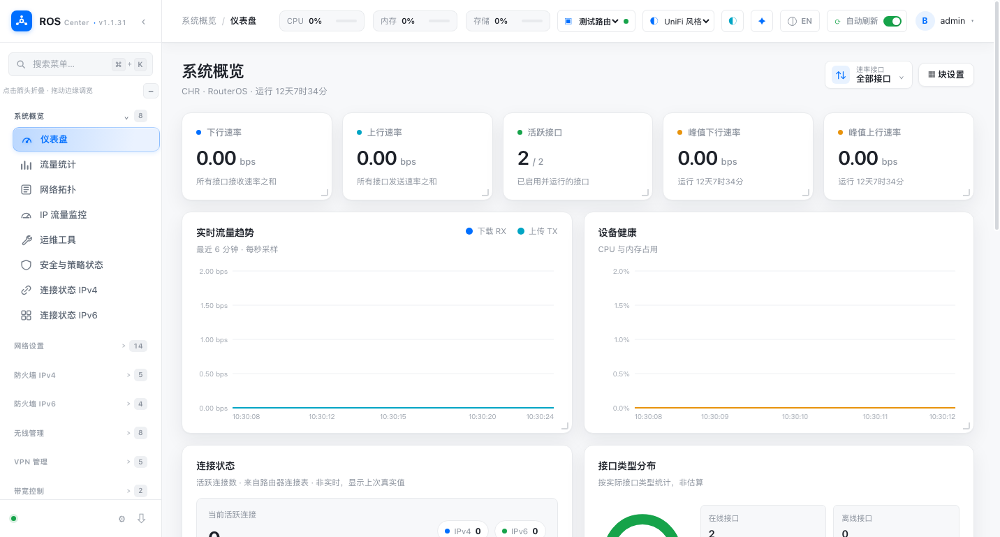
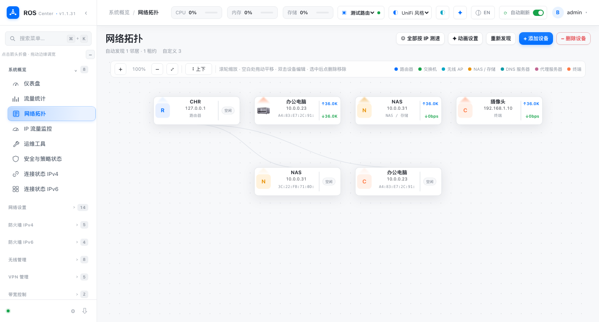
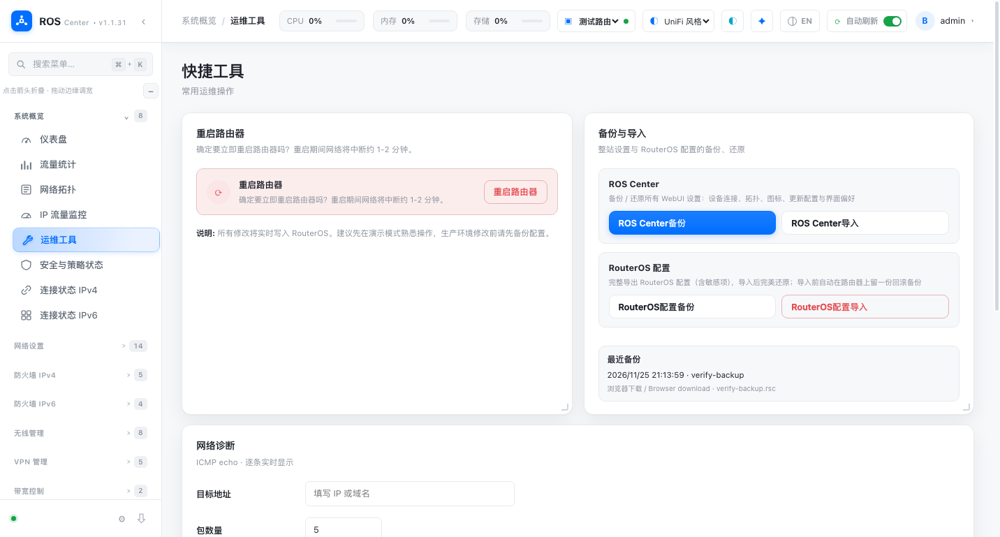
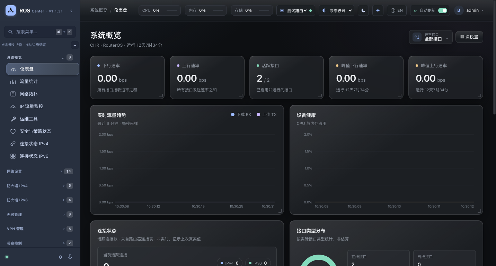

# ROS Center · RouterOS Control Center

[中文文档](README.md)

A lightweight, dependency-free RouterOS multi-device control center: live traffic, traffic statistics, categorized config, network topology and backup/restore — all in one Docker image. It talks to RouterOS over API (8728/8729); no scripts or containers are needed on the router.

## Screenshots

| Dashboard | Network topology |
| --- | --- |
|  |  |

| Backup & restore | Liquid glass theme |
| --- | --- |
|  |  |

More screenshots: [docs/screenshots](docs/screenshots).

## Features

- **Multi-device**: switch from the top bar; add / edit / test / remove devices; each device has its own connection, history and config cache
- **Dashboard**: native `monitor-traffic` streaming; total up/down, trend chart, interface type breakdown, connection ranking, device health; drag-to-reorder and show/hide blocks
- **Traffic statistics**: reads real interface counters, sampled every second and accumulated per interface per day; survives PPPoE re-dials; today/week/month/all-time trends
- **Network topology**: auto-discovery via neighbours + DHCP leases; draggable layered layout, zoom/pan, per-node icon and live up/down rates; type-coloured flashlight beams that brighten with traffic; per-IP live measurement and calculated-flow nodes
- **Categorized config**: interfaces, IP, DHCP, DNS, routes, firewall, WiFi, AC, PPP, WireGuard, queues, users, scripts and more; full CRUD, search, sort, adjustable columns and block sizes; DHCP leases reuse topology device live rates
- **Backup & restore**: one-click backup/restore of all WebUI settings, plus full RouterOS config export (including sensitive entries) with an automatic rollback backup before import
- **Maintenance tools**: reboot, ICMP diagnosis with live results, real-time event stream, recent config changes; update checker with in-app self-update; one-click network setup
- **Bilingual & themes**: switch Chinese/English in one click; 14 colour schemes × light/dark/system, including an Apple-style liquid glass theme
- **Security**: WebUI session login; credentials encrypted at rest with AES-256-GCM

## Quick start

Docker Compose (recommended):

```bash
mkdir ros-center && cd ros-center
curl -O https://raw.githubusercontent.com/BackspaceM/ros-center/main/docker-compose.yml
mkdir -p data && docker compose up -d
```

Open `http://<host-ip>:10086` and add your RouterOS under "System → Device manager". Connection settings, credentials, themes and update options are all edited in the WebUI — no `.env` file needed.

Other options (desktop installers / portable / local Node): see [Releases](https://github.com/BackspaceM/ros-center/releases).

## RouterOS preparation

A read-only account is enough for monitoring:

```routeros
/user group add name=webui policy=read,api
/user add name=webui group=webui password=change-me
/ip service set api address=10.0.0.0/24
/ip firewall filter add chain=input protocol=tcp dst-port=8728 src-address=10.0.0.0/24 action=accept place-before=0
```

Grant only the required menus to accounts that need write access; never use a full-privilege account.

## Security notes

API (8728) is plain text by default — use it only on a trusted LAN, and enable API-SSL (8729) with a certificate for public networks. Set a WebUI login password and put an HTTPS reverse proxy in front before exposing it to the internet. `data/` holds all settings and statistics: persist the whole directory and restrict its permissions.

## License

MIT
